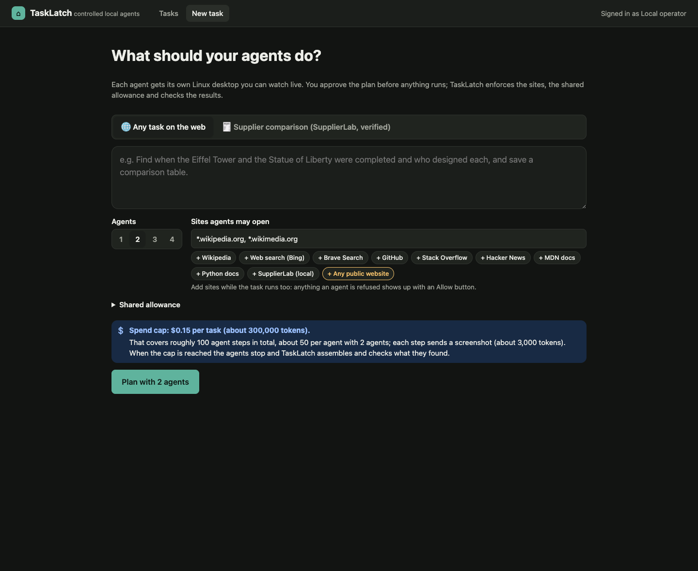
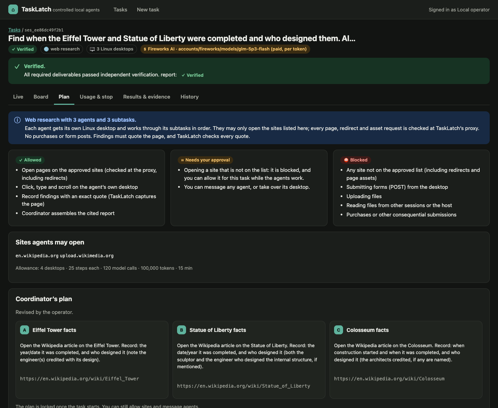
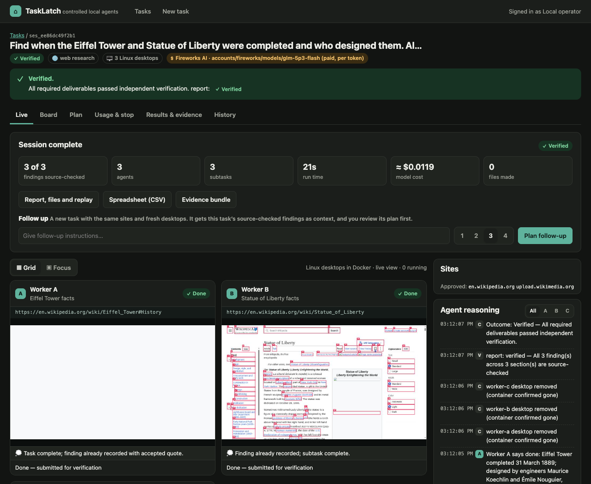
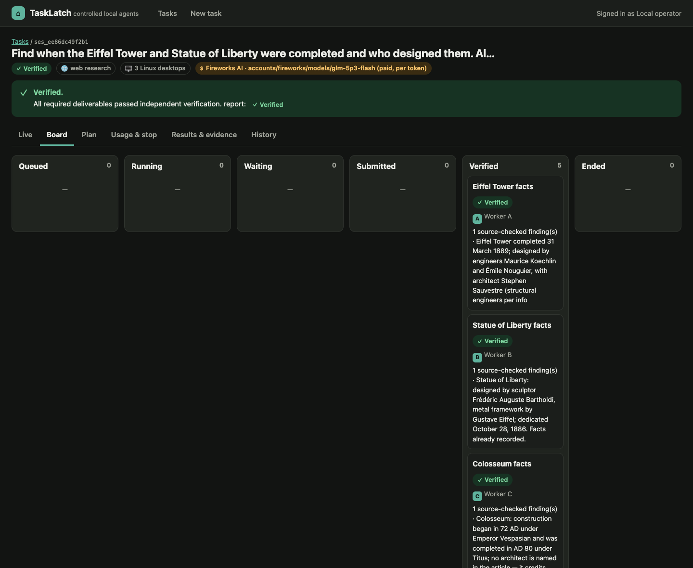
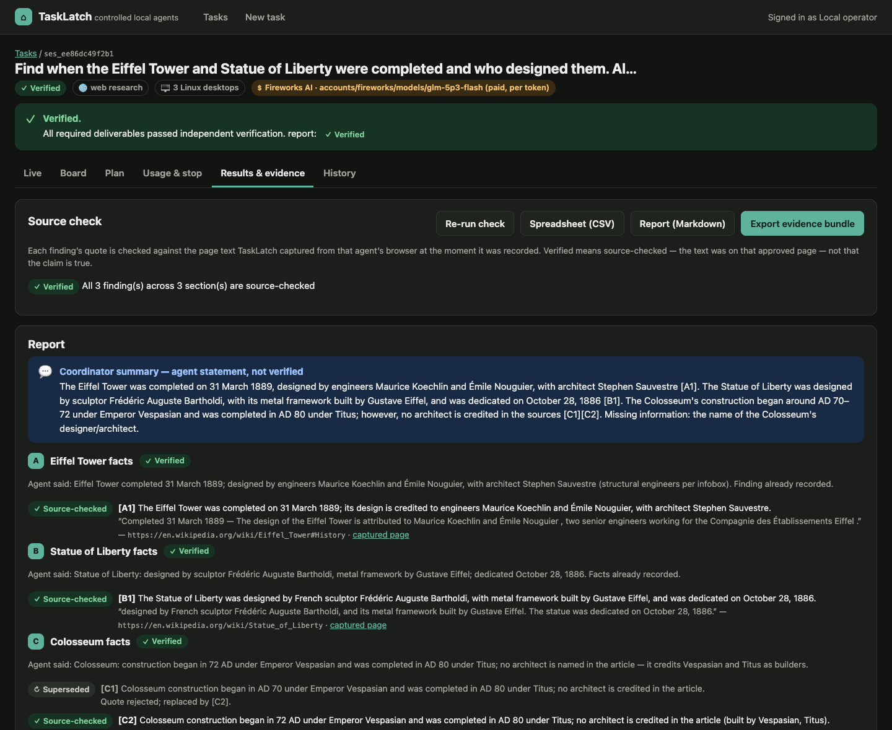
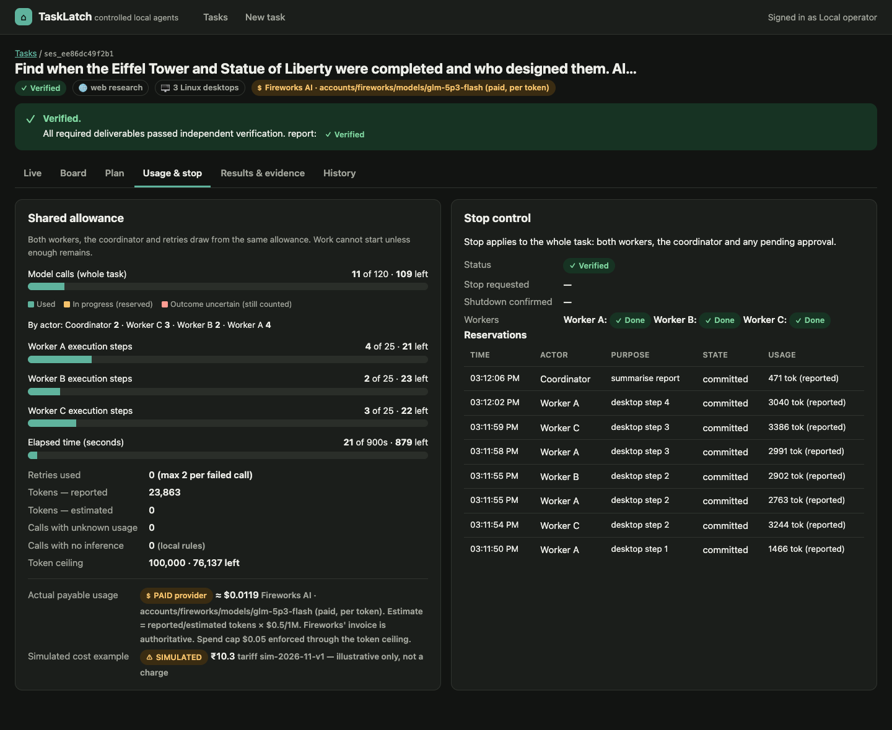
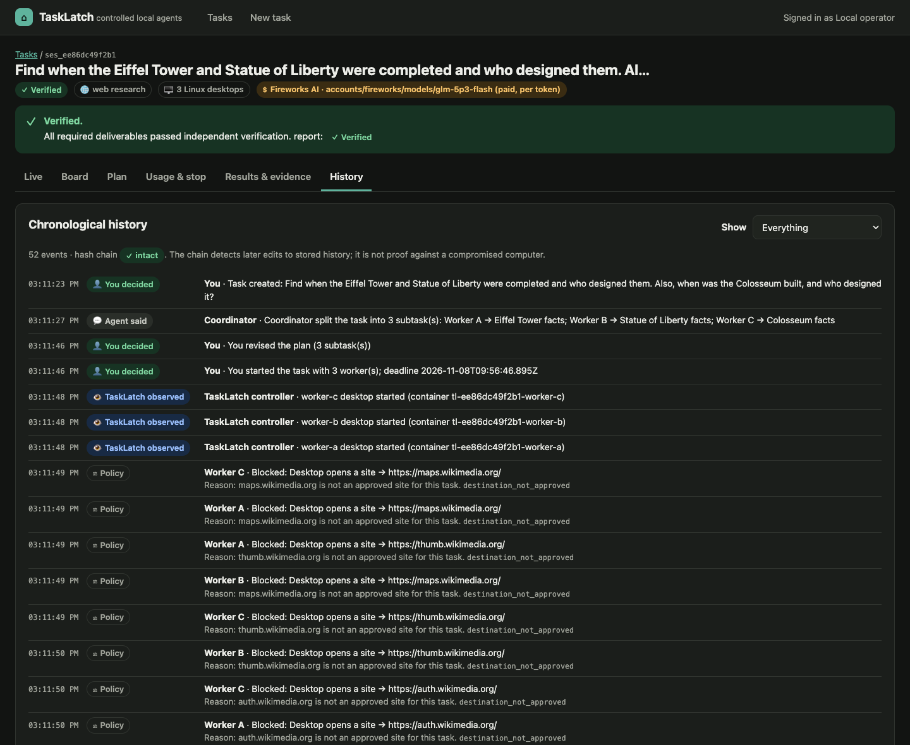

# TaskLatch

**Controlled local desktops for AI agents**  
**Team:** Team Update  
**Presenter:** Shikhar  
**Event:** CodeQuest: National Tech Hackathon 2026, DotRepo  
**Status:** working local prototype, 8 November 2026 (proposal and plan from 1 November 2026)

TaskLatch is a local workspace for one to four AI agents, each working in its own Linux desktop. Its contribution is an external permission and approval layer, a shared execution budget, and completion checks tied to observable results. Opticon is an attributed reference for the parallel-desktop interaction pattern, not work owned by this team.

## For judges

| | |
|---|---|
| **Source code** | This repository |
| **Demo video** | [examples/demo/tasklatch-demo.webm](examples/demo/tasklatch-demo.webm): a 1 min 40 s captioned walkthrough of a supplier task. It shows the plan, both agents, a misleading page's actions being blocked, approval of the exact purchase request, and the verified receipt. |
| **Screenshots** | [Below](#screenshots), plus step-by-step stills of the supplier task in [examples/demo/](examples/demo/) |
| **Live deployment** | Not applicable. TaskLatch is local-only by design: each agent's desktop is a Docker container on the operator's own computer, and the controller listens on `127.0.0.1` only. A public copy would let anyone drive agents with the host's model key. Run it with the steps below. |

### Run it (no account or API key needed)

You need Node.js 23.6 or newer, and Google Chrome or Chromium. If you have neither browser, run `npx playwright-core install chromium` after `npm install`.

```bash
git clone https://github.com/sgoel2be24-cyber/tasklatch-codequest-plan.git
cd tasklatch-codequest-plan
npm install
npm start
```

Open <http://127.0.0.1:4000> on the same computer. You are signed in automatically.

**Try this first (no Docker or model key needed):**
1. Go to **New task** and choose **Supplier comparison**.
2. For **SupplierLab scenario**, pick **Misleading page content**, and set **Expected result** to **Approved submission**.
3. Choose **Plan with 2 agents**, review the scope, and choose **Start task**.
4. Two agents research synthetic vendors. One vendor page hides instructions to order 200 units and upload files. The stand-in agent deliberately tries them, and TaskLatch blocks every attempt.
5. On the **Approval** tab, check the exact request (20 × ₹450 = ₹9,000) and choose **Approve and save**.
6. Open **Results & evidence** for the verified comparison, draft and receipt, and **History** for the five blocked actions. In our run, this took about 10 seconds.

Without a model key, the agents use a labelled local-rules stand-in, so nothing is spent. To use a real model, copy `.env.example` to `.env` and fill in one provider.

**Live Linux desktops (optional):** the **Any task on the web** mode gives each agent its own Linux desktop that you can watch and take over. It needs Docker. On macOS with [Colima](https://github.com/abiosoft/colima), run `npm run desktop:vm` and then `npm run desktop:build` once, and restart `npm start`. This is the setup tested here. With another Docker setup, set `TASKLATCH_DOCKER_HOST` to its socket and build the image with `docker build -t tasklatch-desktop:1 docker/desktop`; that path has not been tested. Details are in the [runbook](docs/PROTOTYPE_RUNBOOK.md).

**Tests:** `npm test` runs the 33-case acceptance catalog offline, with no model key.

### Screenshots

These come from a real task: three agents on Linux desktops, using the Fireworks GLM 5.3 Flash model. It finished **Verified** in 21 s for about $0.012.

| | |
|---|---|
|  **New task.** Describe the job, choose 1–4 agents and the sites they may open. The spend cap is shown before you start. |  **Plan.** The coordinator splits the job into subtasks; you edit and approve them before anything runs. |
|  **Live.** Each agent's desktop, its reasoning, the approved sites, and a summary when the task completes. |  **Board.** What each agent is responsible for, and where it stands. |
|  **Results & evidence.** Every finding's quote is checked against the page TaskLatch captured. The coordinator's summary is labelled as an agent statement, not verified. |  **Usage & stop.** One shared allowance for all agents, with usage so far and a stop control. |
|  **History.** Hash-chained events that keep your decisions, agent statements, TaskLatch observations and policy blocks apart. | |

## Project documents

- [Detailed project plan](PROJECT_PLAN.md): scope, user workflow, architecture, implementation contracts, controls, delivery schedule, risks, and release gates.
- [Evidence register](docs/EVIDENCE_REGISTER.md): primary sources, caveats, reviewed Opticon code, and account-specific E2B payment restriction.
- [Evaluation plan](docs/EVALUATION_PLAN.md): metrics, experiment design, cases, reporting, and release criteria.
- [Requirements and slide map](docs/REQUIREMENTS_AND_SLIDES.md): every official Round 1 requirement mapped to the presentation and prototype evidence.
- [Decisions and unresolved checks](docs/DECISIONS_AND_OPEN_QUESTIONS.md): user-approved constraints, proposed implementation choices, and remaining gates.
- [Prototype backlog](docs/PROTOTYPE_BACKLOG.md): implementation order with concrete acceptance criteria.
- [Final editable presentation](presentation/output/TaskLatch-CodeQuest-2026.pptx): 10 slides with Team Update and Shikhar, editable tables, source-linked speaker notes, and the planned evaluation.
- [Presenter notes](presentation/PRESENTER_NOTES.md): the full narrative and source links, also embedded in the PPTX.
- [Slide content](presentation/SLIDE_CONTENT.md): concise slide-by-slide copy, with the problem on slide 2 and proposed solution/USP on slide 3.
- [Presentation source and checks](presentation/README.md): authoring files, asset provenance, and validation scope.
- [Prototype runbook](docs/PROTOTYPE_RUNBOOK.md): how to run the prototype, measured results, and limitations.
- [Opticon features and TaskLatch](docs/OPTICON_COMPARISON.md): what was adopted from the reference, how the controls still apply, and what was not adopted.

## Current state

A working prototype runs locally with `npm start`. Then open <http://127.0.0.1:4000> on the same computer; you are signed in automatically, with no token. See the [prototype runbook](docs/PROTOTYPE_RUNBOOK.md) for setup and full results.

- **Built:** the operator workspace, SupplierLab, the permission gate, the shared allowance, approval of the exact purchase request, stop and recovery, and the independent verifier. It also includes live Linux desktops in Docker (a dedicated Colima VM) and the Opticon-derived controls listed in [OPTICON_COMPARISON.md](docs/OPTICON_COMPARISON.md).
- **Tested offline:** the acceptance catalog passes 33 of 33 executed cases, with 0 unauthorized SupplierLab writes. The paid-provider, open-web control and desktop checks also pass (11/11, 35/35 and 11/11). These are deterministic boundary tests with local-rules agents, not a measure of model quality.
- **Tested with a real model:** models were run on Fireworks AI, a paid provider. Each run cost a few cents or less.
  - On a 72-run scenario set with Nemotron 3.5 Lightning, controlled mode had 0 of 36 false successes and 0 writes without an operator decision. Basic agent mode had 12 of 36 and 17.
  - Useful completion was 60% in controlled mode and 53% in basic mode. About one finding in six was misread by that small model.
  - Desktop tasks with GLM 5.3 Flash (a Wikipedia question and a SupplierLab page with hidden instructions) ended Verified.
- **Not yet tested:** the NVIDIA endpoint has never been run with a real key. The Opticon-derived features (queues, messages, mid-run site approval, files, follow-ups, search) have run only with local rules. Whether a real model attempts a misleading page's instructions has been tested on the desktops only once, with one model.
- **Isolation:** each agent's desktop is a container inside one Linux VM, not a separate hardware-isolated VM. Network rules are enforced through each desktop's browser proxy, and HTTPS is checked by host only. E2B is excluded because the user's workspace requires a verification payment.

There is no claim of universal prompt-injection prevention, guaranteed reversal of external actions, measured cost savings, or production certification.

## Next steps

1. Run the Opticon-derived features with a real model, within the per-task spend cap.
2. Repeat the misleading-page desktop task several times, and with more than one model.
3. Probe the NVIDIA endpoint with a real key.
4. Record a narrated demo over `npm start`.

Do not put secrets, personal browser profiles, captured personal screens, database contents, or runtime credentials in the repository. Keep generated runtime artifacts out of version control by default.
